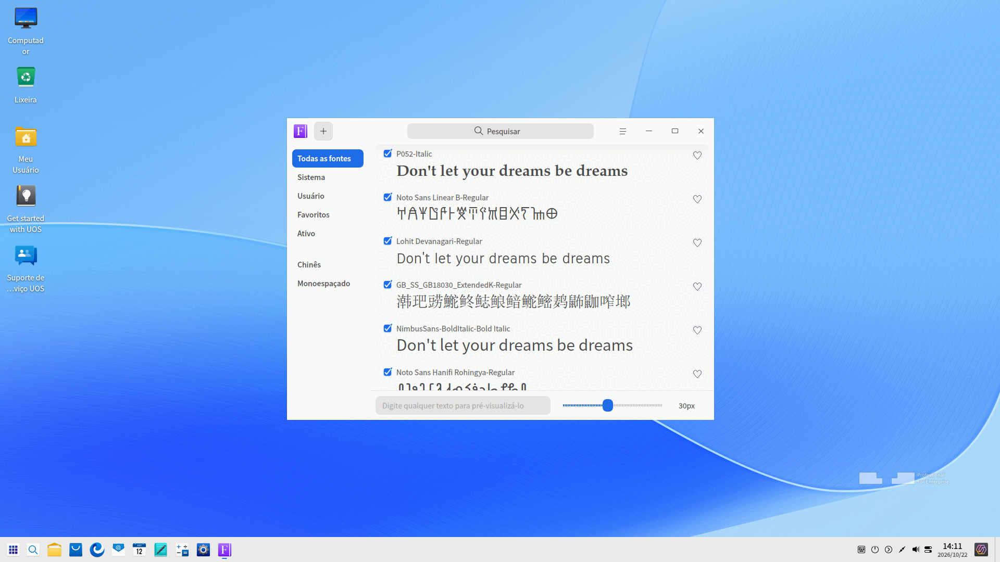
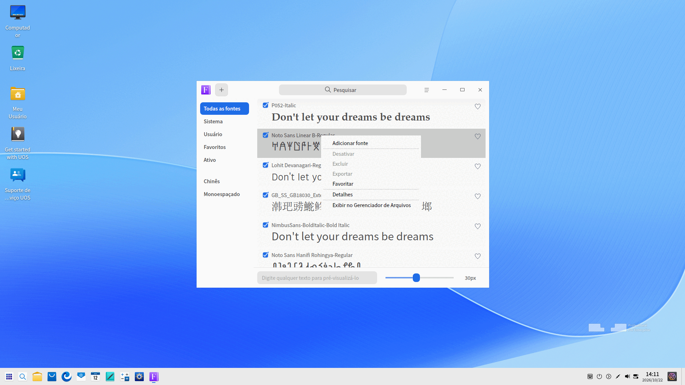
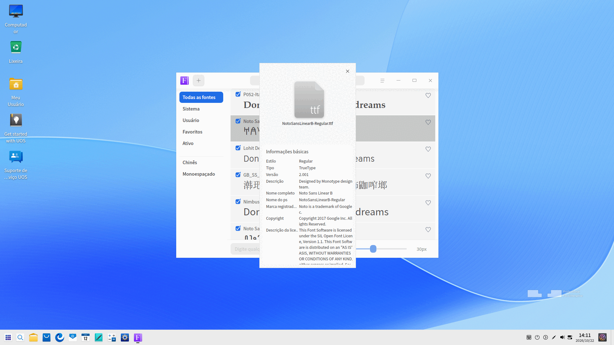

# Gerenciador de Fontes|deepin-font-manager|

## Visão Geral

O Gerenciador de Fontes é uma ferramenta poderosa para o gerenciamento de fontes. Com ele, você pode não apenas pesquisar, instalar, ativar, desativar e excluir fontes, mas também pré-visualizar tipografias inserindo textos personalizados e ajustando o tamanho da fonte.

Há suporte para fontes nos formatos TTF, TTC e OTF.

## Guia

Você pode executar, fechar e criar um atalho na área de trabalho para o Gerenciador de Fontes das seguintes maneiras:

### Executar o Gerenciador de Fontes

1. Clique no ícone do Iniciador  no Dock para abrir a interface do Iniciador.

2. Localize o Gerenciador de Fontes  rolando a roda do mouse ou pesquisando por "gerenciador de fontes" no Iniciador e clique nele para executar.

3. Clique com o botão direito em  e você poderá:

   - Clicar em **Enviar para a área de trabalho** para criar um atalho na área de trabalho.
   - Clicar em **Fixar no dock** para fixá-lo no Dock.
   - Clicar em **Adicionar à inicialização** para que o aplicativo seja executado automaticamente ao iniciar o sistema.

### Sair do Gerenciador de Fontes

- Clique em  na interface do Gerenciador de Fontes para sair.
- Clique com o botão direito em  no Dock e selecione **Fechar tudo** para sair.
- Clique em  na interface do Gerenciador de Fontes e selecione **Sair** para fechar o aplicativo.

### Exibir Atalhos

Na interface do Gerenciador de Fontes, pressione **Ctrl** + **Shift** + **?** no teclado para visualizar os atalhos. A familiaridade com os atalhos aumentará significativamente a sua produtividade.

## Operações

### Apresentação da Interface

| Nome | Descrição |
| ---------- | ------------------------------------------------------------ |
| Todas as fontes | Coleção de todas as fontes do sistema e do usuário, exibida por padrão. |
| Sistema | Lista de fontes integradas ao sistema. As fontes deste conjunto não podem ser excluídas nem desativadas. |
| Usuário | Lista de fontes instaladas pelo usuário. |
| Favoritos | Lista das suas fontes marcadas como favoritas. |
| Ativas | Coleção de todas as fontes que estão atualmente ativadas e prontas para uso. |
| Chinês | Caracteres chineses em todos os conjuntos de fontes. |
| Monoespaçada | Todas as fontes com caracteres de largura uniforme (largura fixa). |

### Instalar Fontes

Com o Gerenciador de Fontes, você pode instalar uma única fonte ou instalar várias fontes em lote das seguintes maneiras:

- Na interface do Gerenciador de Fontes, clique em , selecione  > **Adicionar fonte** ou clique com o botão direito em uma fonte e selecione **Adicionar fonte**.
- Dê um clique duplo no arquivo da fonte.
- Clique com o botão direito no arquivo da fonte e selecione **Abrir com** >  **Gerenciador de Fontes** para entrar na interface e instalar a fonte.
- Arraste o arquivo da fonte diretamente para o ícone ou para a janela do Gerenciador de Fontes.

>  Notas: 
>
> - O Gerenciador de Fontes detectará suas fontes automaticamente. Se a fonte já estiver instalada localmente, uma mensagem avisará que uma versão idêntica já foi instalada. Você pode selecionar **Sair** ou **Continuar** para prosseguir com a instalação.
> - Você pode ir em **Centro de Controle** > **Personalização** > **Fonte** e definir a fonte como a **Fonte Padrão** do sistema.

### Pré-visualizar Fontes

Cada bloco de texto exibe o estilo da fonte correspondente nos conjuntos de fontes, permitindo verificar a aparência visual antes do uso.

O texto de exemplo padrão para visualização é **Don't let your dreams be dreams**, exibido em inglês.

1. Digite o texto na caixa de entrada de pré-visualização na parte inferior da interface do Gerenciador de Fontes.
2. Defina o tamanho da fonte arrastando a barra deslizante horizontalmente.
3. Observe o efeito visual na lista de fontes.

   >  Notas: Arraste a barra para a esquerda para diminuir o tamanho e para a direita para aumentar. O tamanho da fonte varia de 6px a 60px.

### Pesquisar Fontes

1. Clique em  na caixa de pesquisa na parte superior do Gerenciador de Fontes.
2. Digite as palavras-chave e os resultados da pesquisa serão exibidos automaticamente.
3. Clique em  ou apague o texto na caixa de pesquisa para limpar o filtro de busca ou cancelar a pesquisa.

### Exportar Fontes

1. Clique com o botão direito em uma fonte na lista **Usuário**.
2. Selecione **Exportar**.

A fonte exportada é salva por padrão na pasta Área de Trabalho, em uma pasta chamada Fontes.

>  Notas: A exportação de fontes individuais e em lote é suportada. As fontes do sistema não podem ser exportadas.

### Favoritar/Desfavoritar Fontes

Você pode marcar ou desmarcar fontes como favoritas no Gerenciador de Fontes.

1. Clique no ícone  à direita de uma fonte não favoritada ou clique nela com o botão direito e selecione **Favoritar**.
2. Clique no ícone  à direita de uma fonte favoritada ou clique nela com o botão direito e selecione **Desfavoritar**.

   A fonte favoritada será exibida na lista **Favoritos**.

>  Notas: O recurso de favoritar/desfavoritar está disponível tanto para uma única fonte quanto para várias em lote.

### Ativar/Desativar Fontes

Você pode ativar ou desativar uma fonte de usuário (ativada por padrão) na interface do Gerenciador de Fontes.

1. Desmarque a caixa da fonte ou clique com o botão direito e selecione **Desativar** para desabilitá-la.
2. Marque a caixa da fonte ou clique com o botão direito e selecione **Ativar**. A fonte será ativada e exibida na lista **Ativas**.

>  Notas: As funções Ativar/Desativar estão disponíveis tanto para fontes individuais quanto em lote. Fontes do sistema e fontes atualmente em uso não podem ser desativadas.

### Exibir Informações Básicas da Fonte

Você pode consultar as informações detalhadas da fonte por meio do Gerenciador de Fontes.

1. Na lista de fontes, clique com o botão direito na fonte desejada e selecione **Detalhes**.
2. Você poderá visualizar o ícone da fonte, nome, estilo, tipo, versão e informações de descrição.

### Exibir Local de Instalação da Fonte

Quando uma fonte for instalada com sucesso, você poderá visualizar o diretório de instalação por meio do Gerenciador de Arquivos.

Clique com o botão direito em uma fonte na lista e selecione **Exibir no gerenciador de arquivos** para abrir a pasta de instalação correspondente.

### Excluir Fontes

Você pode excluir fontes indesejadas pelo Gerenciador de Fontes.

>  Notas: A exclusão está disponível para fontes individuais e em lote. Fontes do sistema e fontes atualmente em uso não podem ser excluídas.

1. Selecione uma fonte na lista **Usuário**, clique com o botão direito e selecione **Excluir**.
2. Clique em **Excluir** na caixa de diálogo de confirmação.

## Menu Principal

No menu principal, você pode alternar temas da janela, consultar o manual de ajuda e obter mais informações sobre o Gerenciador de Fontes.

### Tema

Existem três opções de tema de janela: Tema Claro, Tema Escuro e Tema do Sistema.

1. Na interface do Gerenciador de Fontes, clique em .
2. Clique em **Tema** para selecionar um tema visual.

### Ajuda

1. Na interface do Gerenciador de Fontes, clique em .
2. Clique em **Ajuda** para visualizar o manual do Gerenciador de Fontes.

### Sobre

1. Na interface do Gerenciador de Fontes, clique em .
2. Clique em **Sobre** para visualizar a versão e a apresentação do Gerenciador de Fontes.

### Sair

1. Na interface do Gerenciador de Fontes, clique em .
2. Clique em **Sair** para fechar o Gerenciador de Fontes.
